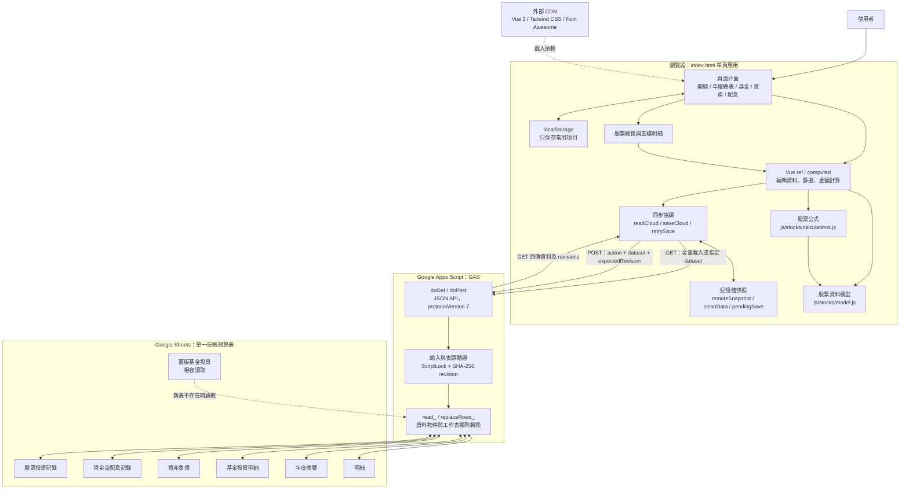
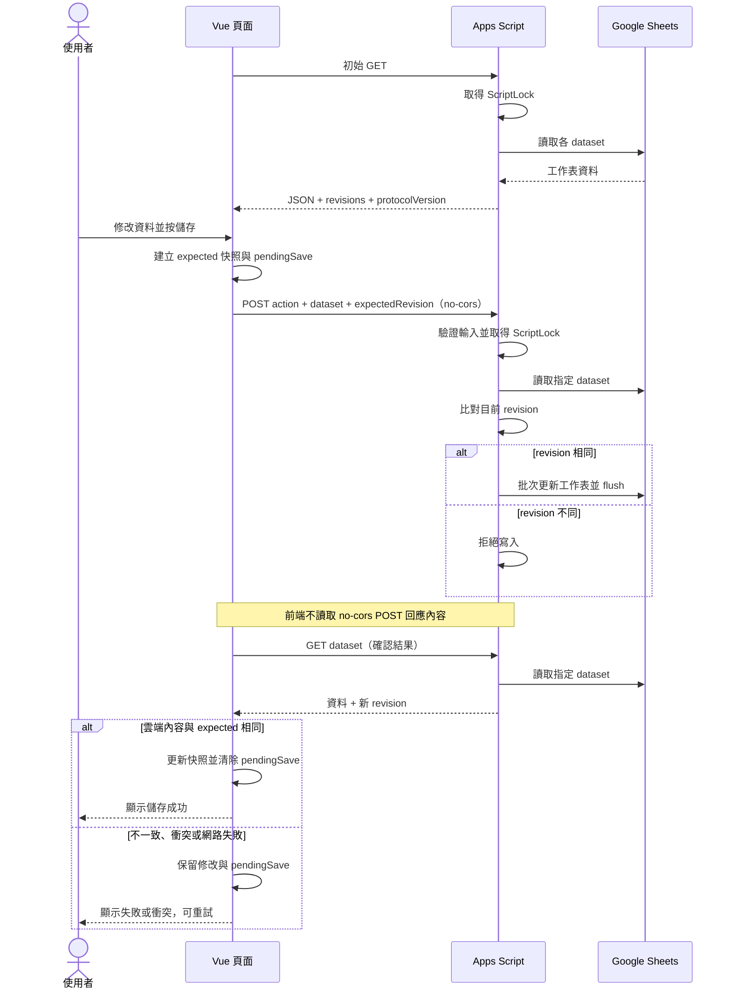
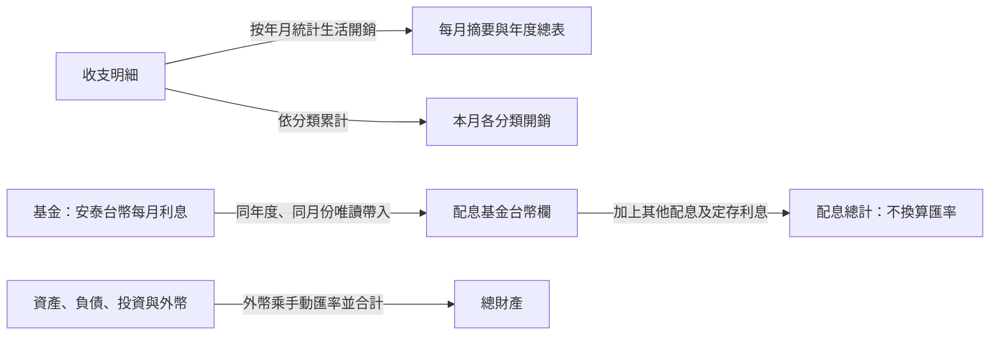
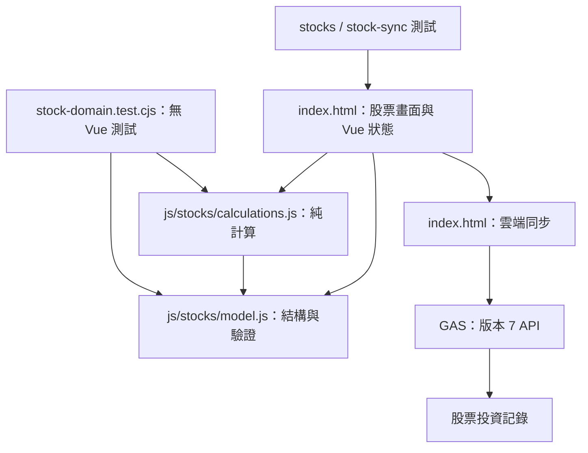

# SkyMoneyBook 工程架構

依 2026-10-15 專案原始碼整理；描述目前實作，不代表正式雲端已部署相同版本。未確認前端託管平台及 Apps Script 實際存取權限。

## 系統架構

股票的資料模型與計算公式已拆成兩個獨立模組；畫面、Vue 狀態與雲端同步仍位於 `index.html`。畫面元件與同步層的拆分留待後續階段。後端是一份 Apps Script 原始碼，Google Sheets 是主要持久化儲存。

## 儲存時序

一般修改是 POST 後 GET 確認，最多嘗試四次確認讀取。重試或沒有新修改時會先 GET：若雲端已有相同內容，直接確認成功；若雲端已被改動，保留修改並拒絕覆蓋。

## 功能與資料映射

| 畫面 | 前端資料 | 儲存 action | 工作表與粒度 |
|---|---|---|---|
| 日常開銷明細 | `transactions` | `saveTransactions` | 明細，5 欄，每筆收支一列 |
| 每月摘要／年開銷總表 | `allSummaries` → API `summaries` | `saveSummary` | 年度摘要，10 欄，年度與月份 |
| 基金投資 | `fundsRecords` | `saveFunds` | 基金投資明細，11 欄，年度／基金／月份；每年度 39 列 |
| 總資產 | `assetsRecords` | `saveAssets` | 資產負債，42 欄，以年月索引 |
| 配息 | `cashflowRecords` | `saveCashflow` | 現金流配息記錄，9 欄，每年度 13 列 |
| 股票 | `stockRecords` | `saveStocks` | 股票投資記錄，8 欄，年度／股票／類型／月份／序號／欄位，每個非空輸入一列 |

每次儲存會提交該類資料的完整集合，並更新對應工作表，不是只更新畫面目前顯示的一筆或一年。

基金和資產資料目前各自保存；圖中没有基金自動同步至資產的資料流。配息提交會帶入基金台幣利息快照，基金有未儲存修改時先阻止配息提交。

## 工程特性與限制

- 前端直接從 CDN 載入依賴，沒有套件管理或建置設定；前端託管位置未記錄於專案。
- 主要財務資料及未確認修改保留在頁面記憶體；`localStorage` 僅保存常用記帳項目，沒有財務草稿持久化。
- 後端以整類資料的內容雜湊做樂觀版本檢查；同一資料類別不同年度的更新也可能互相衝突。
- `ScriptLock` 協調同一 Apps Script 專案的請求，無法鎖住使用者直接編輯 Sheets 或其他 Apps Script 專案的寫入。
- 六類資料獨立儲存，沒有跨工作表交易；基金與配息的先後儲存約束由前端處理。
- 原始碼沒有自行實作登入與使用者授權；實際存取控制依 Apps Script 部署設定，尚未驗證。
- `tests/sync.test.cjs`、`tests/cashflow.test.cjs` 用模擬網路與試算表驗證邏輯；`tests/browser-sync.cjs` 使用 Vue 與 Chromium，但試算表仍是模擬。本階段 66 項單元及模擬同步測試通過；未執行瀏覽器實機驗證或操作正式財務資料。

## 原始碼定位

- `index.html`：介面、Vue 狀態、其他頁面計算、搜尋、同步及未儲存提醒。
- `js/stocks/model.js`：獨立股票資料模型、快照正規化與輸入驗證。
- `js/stocks/calculations.js`：獨立股票計算公式與各層總計；只讀取輸入。
- `STOCKS_SPEC.md`：股票資料關聯、單位、公式、結算與儲存格式。
- `GAS`：API、資料驗證、版本檢查、工作表讀寫與舊格式相容。
- `SYNC_SETUP.md`：部署與同步協定說明。
- `CASHFLOW_SPEC.md`：配息欄位與基金利息帶入規則。
- `tests/`：獨立股票模型／公式、股票整合、同步、配息與瀏覽器測試。
- `backups/`：本地修改前的原檔備份，不是雲端財務資料備份。

## 股票模組依賴（第一階段）

資料模型、公式不讀寫 DOM、網路或 Vue 狀態；計算引擎透過 getter 取得當下的輸入，雲端重新載入替換資料時不會保留舊資料參照。畫面仍負責可編輯代理與目前選擇，歷史結算優先規則集中由公式模組判斷。

本階段保留試算表格式、後端協定與既有畫面結構。發布前端時需包含 `index.html`、`js/stocks/model.js` 及 `js/stocks/calculations.js`，不新增建置或套件安裝步驟。
